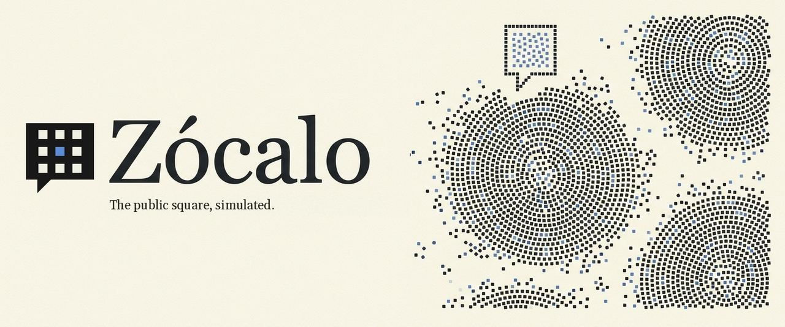

<h1 align="center">Zócalo</h1>

<p align="center">
  <b>The public square, simulated.</b><br>
  Build a population from real census and survey records, ask it anything, talk to any person in it,<br>
  and see every answer with how far off it is likely to be, measured rather than assumed.<br>
  Open source, self-hosted, any model.
</p>

<p align="center">
  
  
  
  
  
</p>

<p align="center">
  <a href="https://github.com/pmsosa/zocalo">Project</a> · <a href="docs/METHODOLOGY.md">Methodology</a> · <a href="docs/DATA.md">Data guide</a> · <a href="#quick-start">Quick Start</a> · <a href="#architecture">Architecture</a>
</p>

<p align="center">
  <a href="docs/METHODOLOGY.md">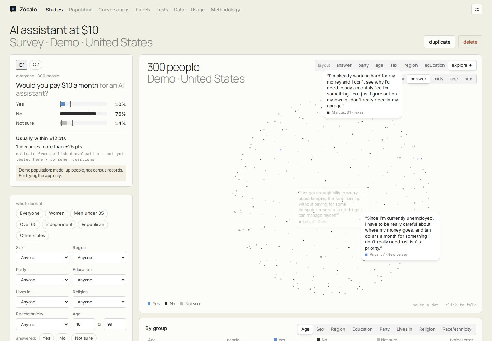</a><br>
  <sub><i>Explore mode: answers pop up as the population turns. The card on the left says how far off these numbers usually are.</i></sub>
</p>

<p align="center">
  <a href="#screenshots">Screenshots</a> · <a href="#features">Features</a> · <a href="#requirements">Requirements</a> · <a href="#development">Development</a> · <a href="#configuration">Configuration</a> · <a href="#project-structure">Project Structure</a> · <a href="#license">License</a>
</p>

> [!TIP]
> **New here?** Read [how Zócalo works](docs/METHODOLOGY.md) first, including what it can't do. Independent tests of
> simulated respondents, Pew Research Center's among them, find them 10–20 points off on average. Zócalo shows you
> that error on every result and lets you measure it yourself.

## Screenshots

Taken from a throw-away demo with made-up people (the built-in demo population), not real census records.

<table>
<tr>
<td width="50%" valign="top">
<a href="docs/METHODOLOGY.md#4-how-error-is-estimated-and-shown">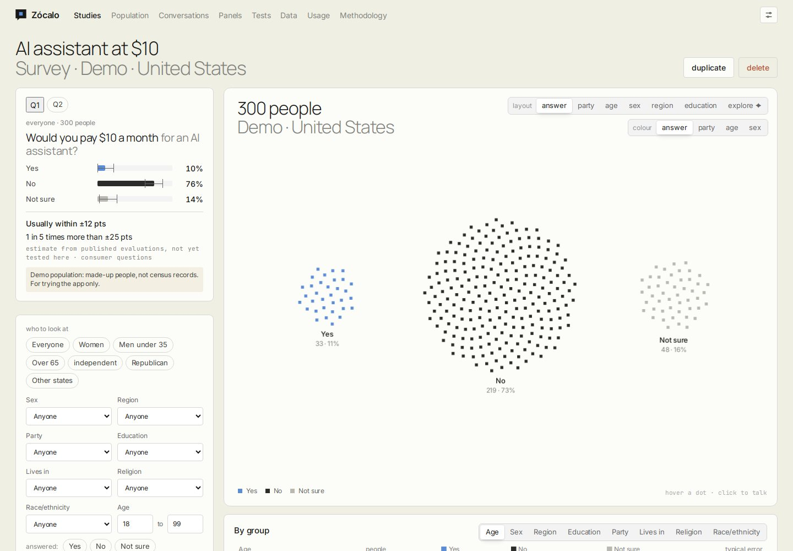</a><br>
<b>Results with labelled error</b><br>
<sub>Every share comes with how far off it usually is, and what kind of estimate that is. Each cluster of dots is the people who gave that answer.</sub>
</td>
<td width="50%" valign="top">
<a href="docs/METHODOLOGY.md#3-kinds-of-study">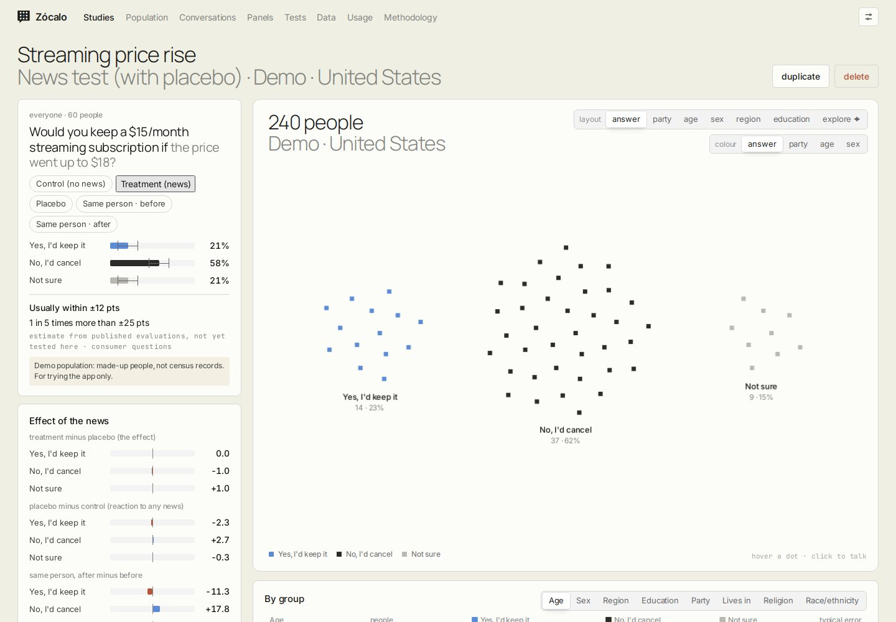</a><br>
<b>News tests with a placebo</b><br>
<sub>The effect is treatment minus placebo, never the raw change. Here the real effect is about 1 point, while asking the same person twice moves 18.</sub>
</td>
</tr>
<tr>
<td width="50%" valign="top">
<a href="docs/METHODOLOGY.md#1-who-the-people-are">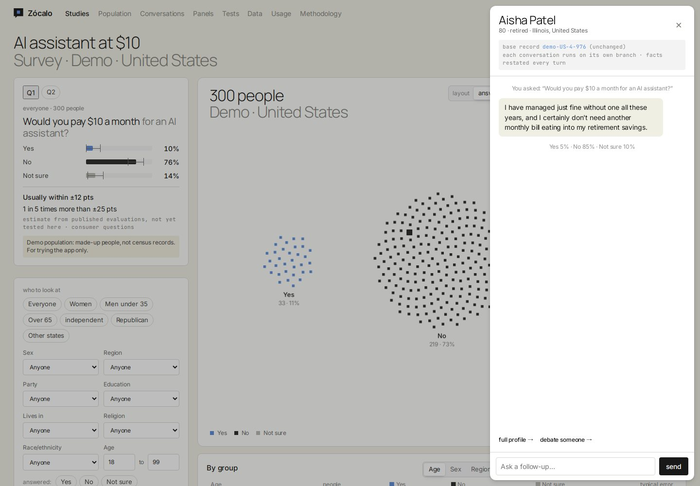</a><br>
<b>Talk to anyone</b><br>
<sub>Click a dot to see why that person answered as they did, and ask follow-ups. Every conversation runs on its own branch, so their record never changes.</sub>
</td>
<td width="50%" valign="top">
<a href="docs/METHODOLOGY.md#1-who-the-people-are">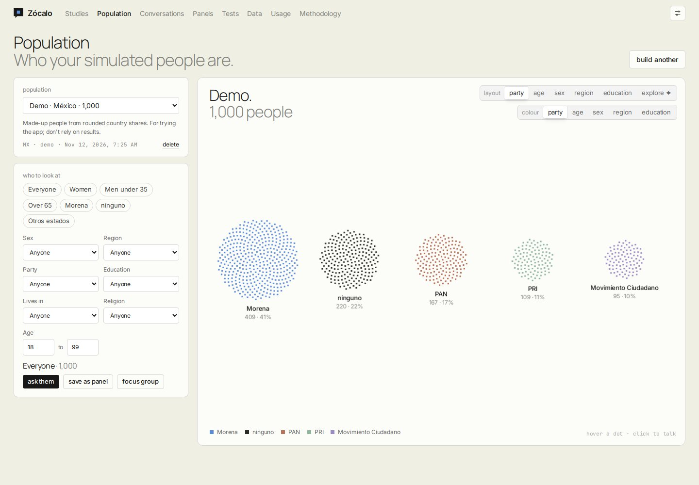</a><br>
<b>Populations from real records</b><br>
<sub>US, UK and Canadian census records, or real survey respondents in over 100 countries, drawn by their official weights. Filter, then ask just those people.</sub>
</td>
</tr>
<tr>
<td width="50%" valign="top">
<a href="docs/METHODOLOGY.md#3-kinds-of-study">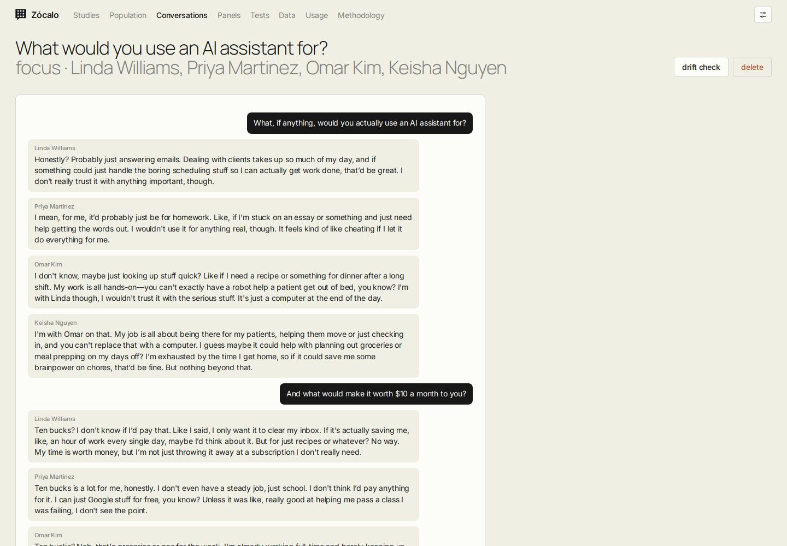</a><br>
<b>Focus groups and debates</b><br>
<sub>A few people and you as moderator, or two sides with pinned positions. Debates show how far each side moved, because simulated groups agree too easily.</sub>
</td>
<td width="50%" valign="top">
<a href="docs/METHODOLOGY.md#6-the-tests">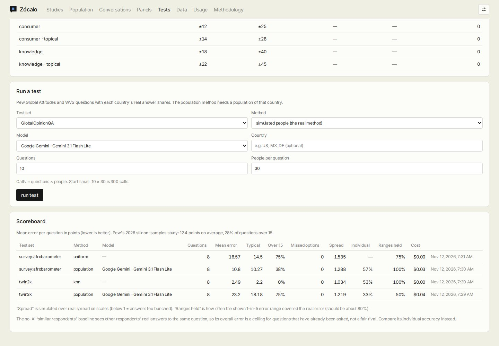</a><br>
<b>Tests built in</b><br>
<sub>Run simulated people and simple baselines on real survey data. Measured error replaces the published starting figures on every result.</sub>
</td>
</tr>
<tr>
<td width="50%" valign="top">
<a href="docs/METHODOLOGY.md#3-kinds-of-study">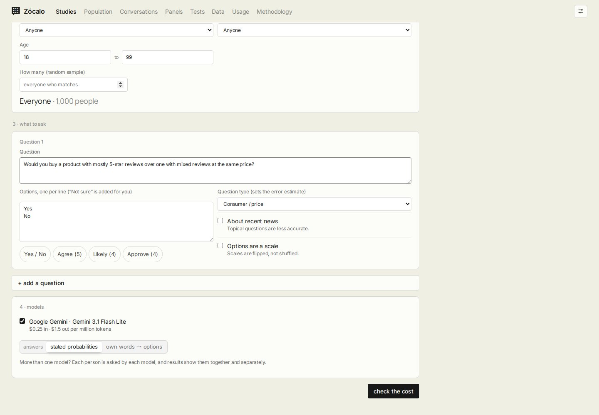</a><br>
<b>Surveys, A/B and news tests</b><br>
<sub>Pick who to ask, write the questions, choose one or more models and see the cost before anything runs.</sub>
</td>
<td width="50%" valign="top">
<a href="docs/METHODOLOGY.md">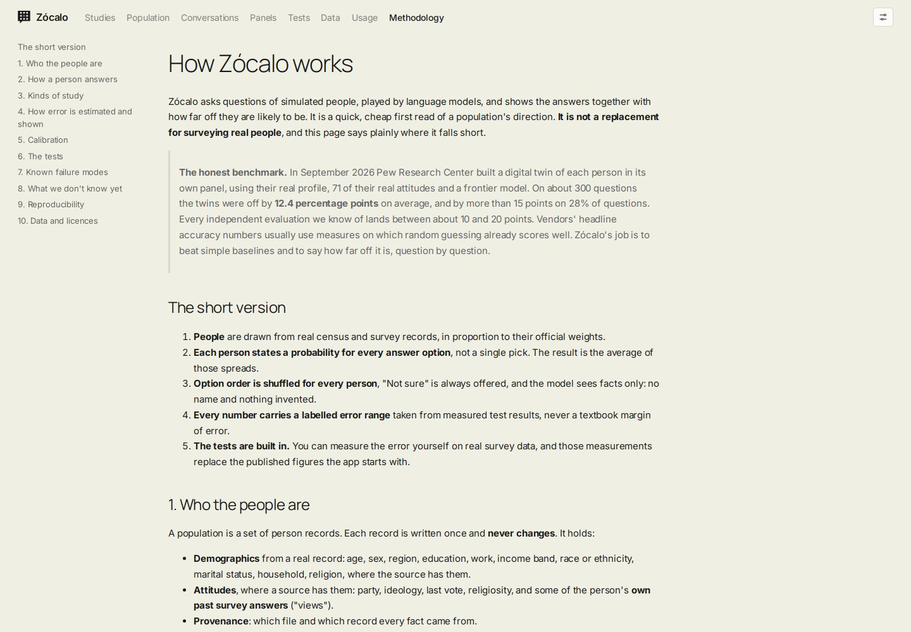</a><br>
<b>The methodology, in the app</b><br>
<sub>How people are built and answer, how error is estimated, the known failure modes, and what nobody knows yet. In English and Spanish.</sub>
</td>
</tr>
</table>

## Features

- **Populations from real data** - US Census ACS records with attitudes matched from CES or GSS; UK and Canada census records; real respondents from WVS, ESS, Afrobarometer, Latinobarómetro, Arab Barometer and Pew; a demo population for trying it out
- **Facts only** - the model sees a person's facts and their own past answers, never an invented backstory, and never their name
- **Stated probabilities** - each person gives a probability for every option; options are shuffled per person and "Not sure" is always offered
- **Labelled error on every number** - measured in your tests, from published evaluations, or flat, and never a textbook margin of error
- **Surveys, A/B tests and news tests** - matched groups; news tests have a placebo arm and an optional same-person group
- **Talk to anyone** - interviews, focus groups and debates on branches that never change the person's record; drift checks
- **Closest real polls** - downloaded surveys are indexed, and each question shows the most similar real questions with their real answers
- **Human-sample correction** - upload a small real sample to turn the error bars into a real 95% confidence interval
- **Tests and baselines** - twins of real respondents, Twin-2K-500, GlobalOpinionQA and SimBench; baselines include uniform, closest poll and a non-AI one
- **Any model** - Gemini, Anthropic, OpenAI, LiteLLM and any OpenAI-compatible server; keys are checked on entry, stored encrypted, and every model gets a test call
- **Costs up front** - an estimate before every run, an optional monthly cap, and a usage page per study, model and month
- **Explore mode** - the population as a turning sphere of dots, with answers popping up as speech bubbles
- **Accessible** - colour-blind palette, shapes as well as colours, larger dots, light and dark themes, English and Spanish
- **Installable** - works as a phone app (PWA); a sign-in mode with admin and invites, or none for personal use

## Architecture

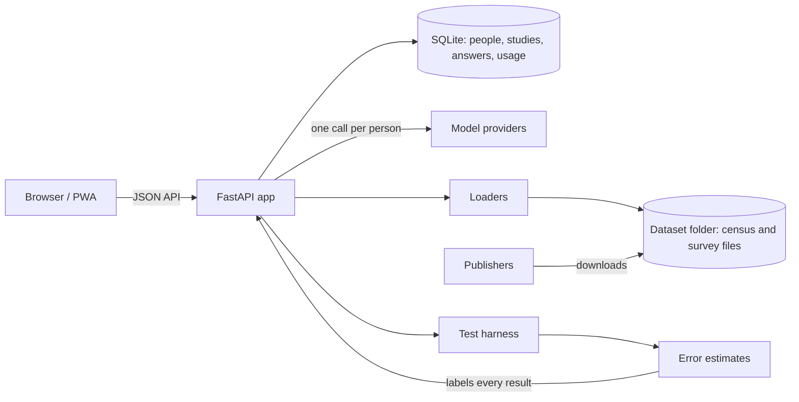

### Components

| Component | Description |
|---|---|
| Web app (`app/zocalo/web/`) | Plain HTML, CSS and JavaScript, no build step; the dot canvas in `static/js/dots.js` |
| API (`app/zocalo/main.py`) | FastAPI routes, sign-in, settings |
| Answering (`app/zocalo/answering.py`) | Prompts, option shuffling, stated probabilities, the own-words method |
| Populations (`app/zocalo/population/`) | Person records, branches, demo populations |
| Data (`app/zocalo/datasets/`) | Source registry, downloads, loaders, attitude matching, question index |
| Studies (`app/zocalo/studies/`) | Matched arms, the runner, results, subgroups and effects |
| Error and calibration (`app/zocalo/errors.py`, `calibration.py`) | Error estimates, anchors, human-sample correction |
| Tests (`app/zocalo/harness/`) | Test sets, baselines, metrics, the scoreboard |
| Conversations (`app/zocalo/chat.py`) | Interviews, focus groups, debates, drift checks |

## Requirements

- Docker with the compose plugin
- A free port (default 8730) and about 1 GB of memory
- An API key for at least one model provider, and room for datasets (from a few MB to about 2 GB, depending on what you download)

## Quick Start

```bash
# 1. Get the code
git clone https://github.com/pmsosa/zocalo.git && cd zocalo

# 2. Start it, with sign-in (default)
./deploy.sh

# ...or for one person on their own machine, without sign-in
./deploy.sh --personal-no-pass

# ...or choose the port and where data and datasets live
./deploy.sh --port 9000 --data-dir /srv/zocalo/data --datasets-dir /mnt/big/zocalo
```

Open `http://localhost:8730` and follow the three steps on the home page: add a model in Settings, build a population,
ask a question. Get real data on the Data page; see the [data guide](docs/DATA.md).
To install it on a phone, serve it over HTTPS (for example behind a reverse proxy).

## Development

### Backend

```bash
docker compose build                                   # build the image
docker run --rm -v "$PWD/app:/srv/app" -v "$PWD/docs:/srv/docs" -w /srv/app zocalo:latest \
  python -m pytest -q tests                            # run the tests (model calls are faked)
docker compose up -d --build                           # rebuild and restart after changes
```

### Frontend

```bash
# No build step: edit app/zocalo/web/static/ and rebuild the container.
# Interface text goes through t("English text"); Spanish lives in static/i18n/es.json.
```

## Configuration

`deploy.sh` writes these to `.env`. Everything the app keeps (the database, settings and encrypted API keys) is in the
data folder: back it up together with `.env`. The dataset folder only holds downloads, which can be fetched again.
Spending caps, providers, models, language and display are set in the app.

| Variable | Description | Default |
|---|---|---|
| `ZOCALO_PORT` | Port on the host | `8730` |
| `ZOCALO_DATA_DIR` | Database, settings and encrypted keys | `./data` |
| `ZOCALO_DATASETS_DIR` | Downloaded census and survey files | `./datasets` |
| `ZOCALO_AUTH` | `accounts` (sign-in) or `none` (personal use; set with `--personal-no-pass`) | `accounts` |

## Project Structure

```text
zocalo/
├── app/
│   ├── zocalo/
│   │   ├── main.py            # API routes, sign-in, settings
│   │   ├── answering.py       # how a simulated person answers
│   │   ├── errors.py          # error estimates and their labels
│   │   ├── calibration.py     # anchors, human-sample correction
│   │   ├── chat.py            # interviews, focus groups, debates
│   │   ├── providers/         # Gemini, Anthropic, OpenAI, compatible servers; prices
│   │   ├── population/        # person records, branches, demo populations
│   │   ├── datasets/          # sources, downloads, loaders, country codes
│   │   ├── studies/           # runner and results
│   │   ├── harness/           # tests and baselines
│   │   └── web/               # the single-page app, icons, fonts, translations
│   └── tests/                 # pytest suite
├── docs/
│   ├── METHODOLOGY.md         # how it works, in plain language (and .es.md)
│   ├── DATA.md                # how to get each dataset (and .es.md)
│   ├── research.md            # the evidence behind the design
│   └── data-sources-tech.md   # URLs, variables and quirks per source
├── deploy.sh                  # one-command deploy
├── compose.yaml
└── Dockerfile
```

## License

[Apache License 2.0](LICENSE). Datasets are not included and keep their publishers' licences; see the
[data guide](docs/DATA.md).
